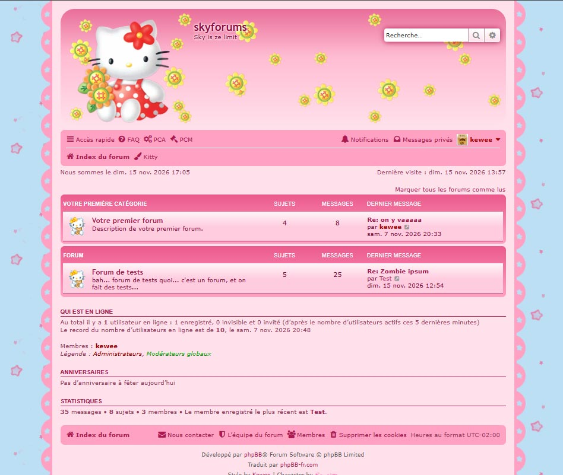

# Kitty 🌸

A little sweetness for your phpBB board!

Kitty is a pink and blue Hello Kitty style, with flowers, stars and decorative borders. Originally created many years ago, it has been refreshed while keeping its cheerful personality.

**Style version:** 3.4.0  
**phpBB version:** 3.3.19  
**Parent style:** prosilver

## Preview

[Try the live demo](https://kewee.pages-perso.free.fr/skyforums/index.php?style=10)

## Features

- Pink and blue colours with floral decorations.
- Hello Kitty illustrations and custom forum and topic icons.
- Transparent decorative borders following the height of the forum.
- Responsive layout inherited from prosilver.
- French and English online-status images.

## Downloads

Packaged versions will be provided through this repository’s **Releases** section, subject to permission for redistribution of the Sanrio artwork.

## Installation

1. Keep prosilver installed: Kitty uses it as its parent style.
2. Extract the downloaded archive.
3. Upload the `Kitty` folder into your forum’s `styles` directory.
4. In the Administration Control Panel, go to **Customise → Install styles**.
5. Install Kitty and select it in your user preferences.

The resulting structure should be `styles/Kitty/style.cfg`, with the `template` and `theme` directories alongside it.

## Credits

- Original design and current update: **Kewee — CRI Studio**.
- Previous technical update: **cabot**.
- Hello Kitty character and artwork: **Sanrio**.

[Visit CRI Studio](https://cristudio.fr/)

## License and artwork

The technical files are distributed under the GNU General Public License, version 2. See `license.txt`.
Hello Kitty and the associated Sanrio artwork remain the property of Sanrio. They are not made freely reusable by the code licence. Permission for redistribution of the updated theme has been requested.

This is an unofficial fan-created theme.
